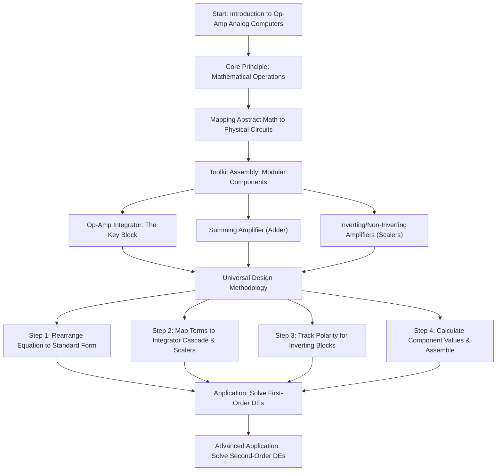
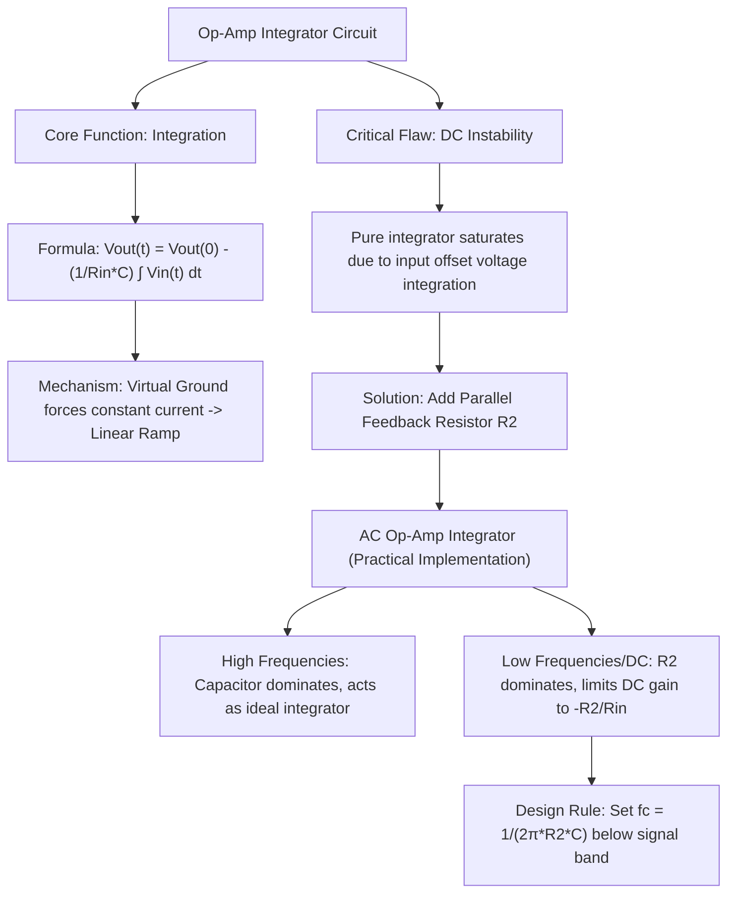
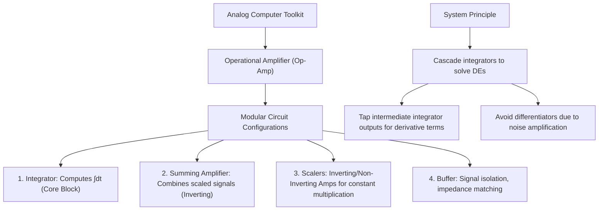
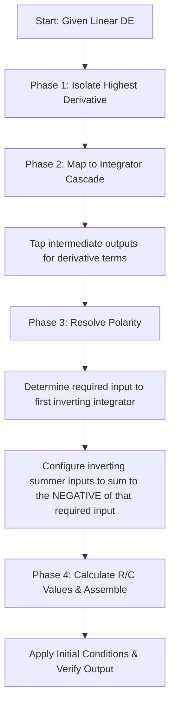
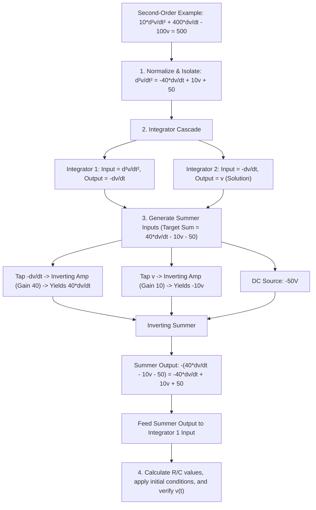

# From Theory to Circuit: A Visual Guide to Solving Differential Equations with Operational Amplifiers

---

# From Theory to Circuit: A Visual Guide to Solving Differential Equations with Operational Amplifiers

## High-Level Conceptual Framework and Actionable Workflow

The foundational concept of analog computing is the repurposing of operational amplifier (op-amp) circuits as an integrated system capable of solving complex mathematical problems, specifically linear differential equations. This approach leverages the historical "operational" use of op-amps to perform mathematical operations like integration, summation, and multiplication by a constant.

The central thesis is that **any linear differential equation with constant coefficients can be solved**, given suitable initial conditions and appropriate voltage/time scaling to prevent op-amp saturation. An analog computer is a physical assembly of interconnected op-amp circuits configured to realize these mathematical functions. The actionability of this framework stems from a systematic method that maps the abstract terms of a differential equation directly onto a corresponding physical circuit layout.

The high-level conceptual flow progresses from a broad idea to a concrete application. It starts with the most critical component, the integrator, and builds a modular toolkit. Once established, a universal design methodology provides a repeatable process for designing a custom analog computer for any given equation.

**High-Level Conceptual Overview (Text Format):**

* **Core Principle:** Translate abstract mathematical operations (integration, summation, scaling) into physical op-amp circuits.
* **System Architecture:** Build a modular system using interconnected blocks. Derivatives are obtained from intermediate integrator outputs, not differentiator circuits.
* **Key Component:** The Op-Amp Integrator is the cornerstone due to its inherent noise-rejection properties compared to differentiators.
* **Universal Methodology:** Apply a standardized design process to any linear differential equation, strictly accounting for the sign inversions inherent in standard op-amp configurations.

---

## The Op-Amp Integrator: Core Component and Its Practical Realization

The op-amp integrator is the most critical building block in an analog computer. Its fundamental purpose is to produce an output voltage proportional to the time-integral of the input voltage. The ideal behavior, including the initial condition, is defined by:

$$
V_{out}(t) = V_{out}(0) - \frac{1}{R_{in}C} \int_0^t V_{in}(\tau) d\tau
$$

The concept of a "virtual ground" at the inverting input is central to its operation. Because the non-inverting input is grounded, the op-amp's high gain forces the inverting input to 0V. This ensures that a constant input voltage $V_{in}$ produces a constant current $I = V_{in}/R_{in}$ that flows directly into the feedback capacitor.

**Correct Step-Response Behavior:** For a constant step input, the capacitor does *not* "charge up" like a passive RC circuit. Instead, the virtual ground maintains a constant current, causing the output voltage to **ramp linearly** ($V_{out}(t) = V_{out}(0) - \frac{V_{in}}{R_{in}C}t$) until the op-amp output reaches its supply rail (saturation).

**DC Instability and the AC Integrator Solution:** A pure integrator is DC-unstable. Any tiny input offset voltage inherent in real op-amps is integrated over time, eventually driving the output into saturation. The standard solution is to place a large-value resistor ($R_2$) in parallel with the feedback capacitor ($C$).

* **Tradeoff & Design Rule:** This creates a low-pass filter with a corner frequency $f_c = \frac{1}{2\pi R_2 C}$. $R_2$ must be chosen large enough so that $f_c$ is well below the lowest signal frequency of interest (preserving integration accuracy), but small enough to limit the DC gain to $-R_2/R_{in}$, preventing offset-induced saturation.

---

## The Circuit Toolkit: Essential Building Blocks

A complete analog computer is built upon a modular toolkit. The principle is inherently modular: complex systems are constructed by connecting these standardized building blocks in a configuration that directly mirrors the structure of the target differential equation.

1. **Op-Amp Integrator:** Computes the time-integral. The primary workhorse of the system.
2. **Summing Amplifier (Inverting Adder):** Combines multiple input voltages. Output: $V_{out} = -R_f \sum (V_i / R_i)$. *Crucial for tracking polarity.*
3. **Inverting/Non-Inverting Amplifiers (Scalers):** Multiplies a signal by a constant factor to match equation coefficients.
4. **Buffer / Voltage Follower:** Provides signal isolation and impedance matching without altering the signal level.

**Note on Differentiators:** While op-amp differentiators exist, they are **optional and generally avoided** in standard analog computing methodologies. They inherently amplify high-frequency noise, leading to instability. Instead, derivative terms ($dy/dt$, $d^2y/dt^2$) are obtained directly by tapping the intermediate outputs of the integrator cascade.

---

## Universal Design Methodology for Solving Differential Equations

This methodology provides a systematic, repeatable workflow for translating an abstract mathematical problem into a concrete physical circuit.

**The Golden Rule of Polarity:** Standard analog computers use *inverting* integrators and *inverting* summers. An inverting summer outputs the *negative* sum of its inputs. Therefore, to make an inverting summer output a target voltage $V_{target}$, you must feed it inputs that sum to $-V_{target}$.

### Phase 1: Algebraic Rearrangement

Isolate the highest-order derivative on the left-hand side of the equation.

* *Example:* $dy/dt + 4y = x(t)$ becomes $dy/dt = -4y + x(t)$.

### Phase 2: Circuit Block Mapping (Integrator Cascade)

1. The number of cascaded inverting integrators equals the order of the highest derivative.
2. The output of the final integrator is the solution $y(t)$.
3. Tap the intermediate outputs of the integrator chain to get lower-order derivatives (e.g., the output of the first integrator in a second-order system is $-dy/dt$).
4. Route these tapped signals through scaling amplifiers to match the coefficients in the rearranged equation.

### Phase 3: Polarity Resolution and Summation

Determine the required input to the *first* integrator. Since the first integrator is inverting, if its input is $V_{in1}$, its output is $-\int V_{in1} dt$.

1. Define $V_{in1}$ based on the rearranged equation.
2. Use an inverting summer to generate $V_{in1}$. Remember: the summer's inputs must sum to $-V_{in1}$.
3. Connect DC sources (with appropriate signs) for constant terms.

### Phase 4: Component Calculation and Verification

1. Choose a standard capacitor $C$ (e.g., $1 \mu F$). Calculate $R$ for integrators to achieve the desired time constant (e.g., $R = 1 M\Omega$ for a 1-second time constant).
2. Calculate resistor ratios for scaling amplifiers to achieve exact gains.
3. Assemble, apply dual power supplies (e.g., $\pm 15V$), apply initial conditions (by pre-charging capacitors), and verify the output waveform against the analytical solution.

---

## Application Through First-Order Differential Equation Examples

### Example 1: $dy/dt + 4y = x(t)$

1. **Rearrange:** $dy/dt = -4y + x(t)$.
2. **Integrator Requirement:** We need one inverting integrator. Let its output be $y$. For the output to be $y$, its input must be $-dy/dt$.
3. **Polarity Resolution:** From the rearranged equation, $-dy/dt = 4y - x(t)$. Therefore, the inverting summer must output $4y - x(t)$.
4. **Summer Inputs:** To make the summer output $4y - x(t)$, its inputs must sum to $-(4y - x(t)) = -4y + x(t)$.
   * Input 1: Pass $y$ through an inverting amplifier with a gain of 4 $\rightarrow$ yields $-4y$.
   * Input 2: Feed $x(t)$ directly (or through a unity buffer) $\rightarrow$ yields $x(t)$.
   * Summer Output: $-(-4y + x(t)) = 4y - x(t)$. This perfectly feeds the first integrator.

### Example 2: $dy/dt + 7y = 3$

1. **Rearrange:** $dy/dt = 3 - 7y$.
2. **Integrator Requirement:** One inverting integrator. Output is $y$, so input must be $-dy/dt$.
3. **Polarity Resolution:** $-dy/dt = 7y - 3$. The inverting summer must output $7y - 3$.
4. **Summer Inputs:** Inputs must sum to $-(7y - 3) = -7y + 3$.
   * Input 1: Pass $y$ through an inverting amplifier with a gain of 7 $\rightarrow$ yields $-7y$.
   * Input 2: Connect a $+3V$ DC source $\rightarrow$ yields $+3$.
   * Summer Output: $-(-7y + 3) = 7y - 3$.
5. **Verification:** The analytical solution is $y(t) = 3/7 + (y(0) - 3/7)e^{-7t}$. The circuit output will exponentially decay or rise to stabilize at the **steady-state equilibrium value** of $y = 3/7$ (approx. 0.429V, assuming 1:1 voltage scaling).

---

## Advanced Application: Solving Second-Order Differential Equations

The scalability of this methodology is demonstrated with higher-order equations. Consider: $10 \frac{d^2v}{dt^2} + 400 \frac{dv}{dt} - 100v = 500$.

1. **Rearrange & Normalize:** Divide by 10, then isolate the highest derivative:
   $\frac{d^2v}{dt^2} = -40 \frac{dv}{dt} + 10v + 50$
2. **Integrator Cascade:** Two inverting integrators are required.
   * Let Integrator 1 input be $\frac{d^2v}{dt^2}$. Its output will be $-\frac{dv}{dt}$.
   * Let Integrator 2 input be $-\frac{dv}{dt}$. Its output will be $-\int (-\frac{dv}{dt}) dt = v$.
   * The final solution $v$ is taken from the output of Integrator 2.
3. **Polarity Resolution:** We need to generate the input for Integrator 1, which is $\frac{d^2v}{dt^2}$. We will use an inverting summer to produce this.
   * Target Summer Output: $\frac{d^2v}{dt^2} = -40 \frac{dv}{dt} + 10v + 50$.
   * Required Summer Inputs (must sum to the negative of the target): $40 \frac{dv}{dt} - 10v - 50$.
4. **Generating Summer Inputs:**
   * **Term 1 ($40 \frac{dv}{dt}$):** We have the signal $-\frac{dv}{dt}$ from Integrator 1. Pass it through an inverting amplifier with a gain of 40. Output = $40 \frac{dv}{dt}$.
   * **Term 2 ($-10v$):** We have the signal $v$ from Integrator 2. Pass it through an inverting amplifier with a gain of 10. Output = $-10v$.
   * **Term 3 ($-50$):** Connect a $-50V$ DC voltage source.
5. **Loop Closure:** Feed the summer's output into Integrator 1. The loop is now mathematically closed with perfect sign consistency.

This rigorous, polarity-aware methodology ensures that the physical circuit behaves as a precise, stable, and verifiable analog computer for any linear differential equation.
